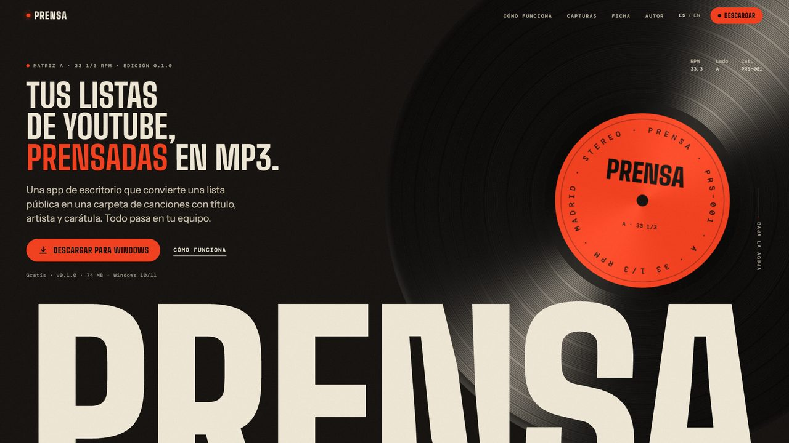
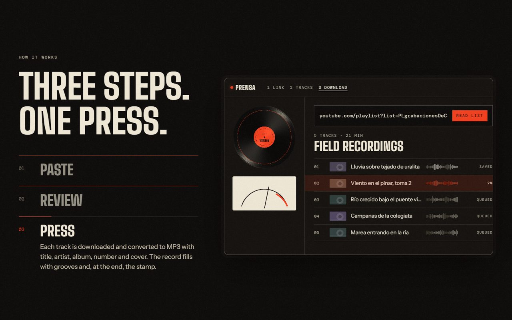
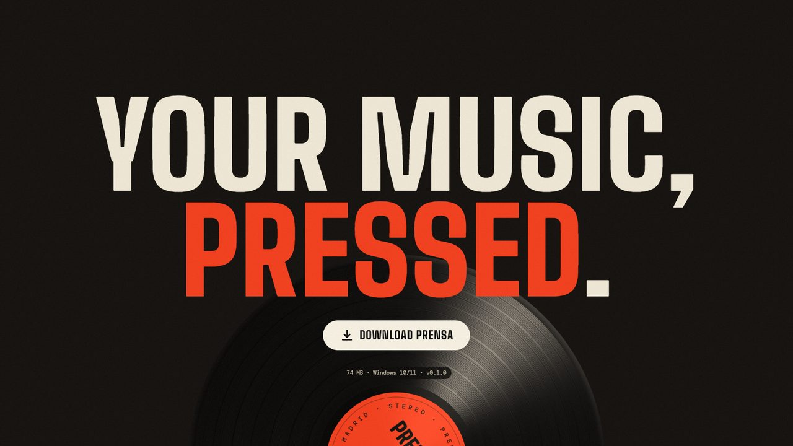
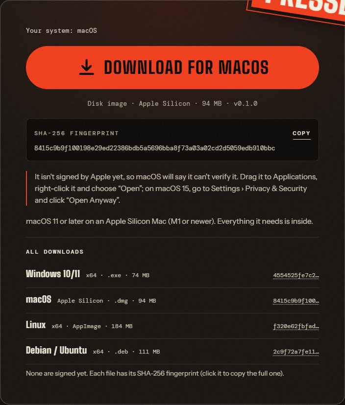
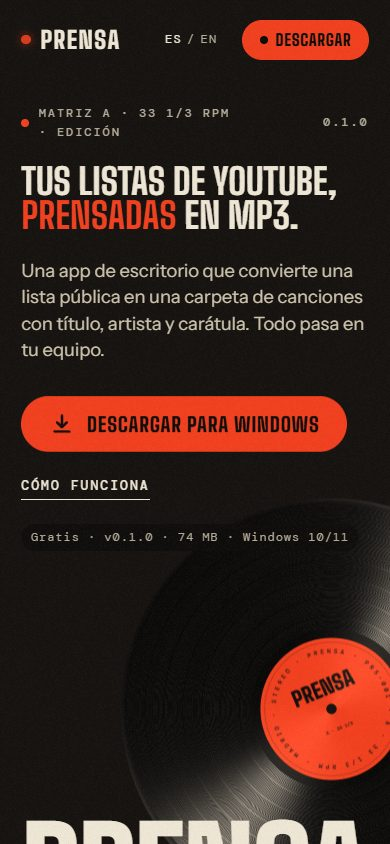
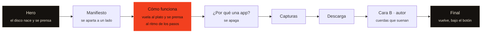

<div align="center">

<a href="https://alonsovine.github.io/prensa-web/"></a>

### La web de presentación y descarga de Prensa

**[→ alonsovine.github.io/prensa-web](https://alonsovine.github.io/prensa-web/)** &nbsp;·&nbsp; [Descargas v0.1.0](https://github.com/AlonsoVine/prensa-web/releases/tag/v0.1.0) &nbsp;·&nbsp; [English](https://alonsovine.github.io/prensa-web/?lang=en)


</div>

> [!NOTE]
> **Prensa** es una app de escritorio que convierte una lista pública de YouTube en una carpeta de MP3 con título, artista, álbum, número de pista y carátula. Todo pasa en tu ordenador: **sin cuentas, sin cookies y sin telemetría**. Este repositorio es su web. Está construida como una sala de máquinas de noche, con papel de etiqueta y una sola luz roja.

<br>

## Lado A · Lo que se oye

<table>
<tr>
<td width="62%"></td>
<td>

**01 · Un disco para toda la página**

Un único vinilo en **WebGL** con surcos procedurales, brillo anisótropo que sigue al cursor y polvo que gira con él. Gira a **33⅓ rpm de verdad** (3,49 rad/s) y el contador del hero muestra sus revoluciones reales: el scroll lo empuja y luego vuelve a su velocidad.

</td>
</tr>
<tr>
<td>

**02 · Se prensa delante de ti**

El disco se aparta, vuela hasta el plato de la app en miniatura de «Cómo funciona» y se prensa allí **surco a surco, de fuera hacia dentro**, con el frente en rojo, mientras la maqueta teclea el enlace, carga las pistas y estampa el sello.

</td>
<td width="62%"></td>
</tr>
<tr>
<td width="62%"></td>
<td>

**03 · Y vuelve al final**

El vinilo sube por debajo de «Tu música, prensada» como si saliera del plato. Antes pasa por un manifiesto que se enciende palabra a palabra, una tabla que tacha la web de conversión fila a fila, una galería de capturas reales y seis cuerdas de guitarra que **suenan** (síntesis Karplus-Strong, también con las teclas 1–6).

</td>
</tr>
</table>

<table>
<tr>
<td width="34%"></td>
<td>

**04 · La descarga que te toca**

La web detecta tu sistema y te ofrece **su** instalador, con su peso, su huella SHA-256 (que se copia con un clic) y las instrucciones honestas para un instalador sin firmar: SmartScreen en Windows, Gatekeeper en macOS y `chmod +x` en Linux. Debajo aparecen todas las descargas.

En el móvil no te ofrece un `.exe`: te propone **enviarte el enlace** para abrirlo en el ordenador.

</td>
<td width="22%"></td>
</tr>
</table>

<br>

## Descargas · v0.1.0

| | Sistema | Archivo | Peso |
|:-:|---|---|--:|
| 🪟 | Windows 10/11 · x64 | [`Prensa_0.1.0_x64-setup.exe`](https://github.com/AlonsoVine/prensa-web/releases/download/v0.1.0/Prensa_0.1.0_x64-setup.exe) | 74 MB |
| 🍎 | macOS 11+ · Apple Silicon | [`Prensa_0.1.0_aarch64.dmg`](https://github.com/AlonsoVine/prensa-web/releases/download/v0.1.0/Prensa_0.1.0_aarch64.dmg) | 94 MB |
| 🐧 | Linux · x64 | [`Prensa_0.1.0_amd64.AppImage`](https://github.com/AlonsoVine/prensa-web/releases/download/v0.1.0/Prensa_0.1.0_amd64.AppImage) | 184 MB |
| 🐧 | Debian / Ubuntu · x64 | [`Prensa_0.1.0_amd64.deb`](https://github.com/AlonsoVine/prensa-web/releases/download/v0.1.0/Prensa_0.1.0_amd64.deb) | 111 MB |

> [!IMPORTANT]
> Los instaladores **aún no están firmados**. Las huellas SHA-256 aparecen en la web y en la [release](https://github.com/AlonsoVine/prensa-web/releases/tag/v0.1.0). Usa Prensa solo con contenido que sea tuyo, que tenga licencia libre o que tengas derecho a descargar.

<br>

## Lado B · Cómo está hecha



- **Un solo vinilo, una función pura del scroll.** `src/secciones/hero.ts` calcula la pose del disco (posición, tamaño, opacidad) a partir del avance de cada tramo, así que puedes ir y volver sin que nada se acumule. El lienzo WebGL no se redimensiona nunca: se escala la capa.
- **El shader** (`src/gl/vinilo.ts`) lo dibuja todo menos la etiqueta, que es un canvas 2D con la tipografía de la marca: microrrelieve de surcos, separaciones entre pistas, brillo que sigue a la luz por el arco más corto y el frente de prensado `uPrensado`.
- **Tramos fijados con `position: sticky`**, no con el `pin` de GSAP. La sección se alarga y su interior se pega, así que el navegador nunca cambia nada de sitio: **CLS 0** al cargar y al recorrer la página (antes llegaba a 1,0).
- **Todo llega en el HTML.** Un plugin de Vite rellena `index.html` con los textos en español, la galería y la lista de descargas al compilar. Sin JavaScript, la página se lee entera; con él, se cambia de idioma en vivo y la URL lo recuerda (`?lang=en`).
- **Movimiento reducido de verdad.** Con `prefers-reduced-motion`, el disco se pinta una vez y queda quieto, no hay scroll suave y todo el contenido está visible desde el principio.
- **Accesible:** foco que nunca cae en algo invisible, copias ocultas para lectores de pantalla en los textos partidos, cinta pausable, estados anunciados y objetivos táctiles de 44 px.

<details>
<summary><b>Estructura</b></summary>

```
index.html                 una sola página; {{clave}} y {{=dato}} se rellenan al compilar
vite.config.ts             plugins: textos, galería, lista de descargas, precarga de fuentes
src/main.ts                arranque: Lenis + ScrollTrigger, idioma, montaje de secciones
src/gl/vinilo.ts           el vinilo (OGL)
src/secciones/             hero, como, porque, capturas, descarga, autor, pie, cabecera, textos
src/efectos/               partir, cursor, magnetico, cinta, precarga, grano, fijar
src/content/               descarga (instaladores), capturas, perfil
src/i18n/                  es.ts, en.ts y el cambio de idioma
src/styles/                tokens (los mismos de la app), fuentes, base, secciones
scripts/recursos.mjs       capturas → WebP, instaladores + SHA-256, iconos
tests/e2e/web.spec.ts      Playwright en escritorio, tableta y móvil
.github/workflows/         publicación en GitHub Pages
```

</details>

<details>
<summary><b>Desarrollo</b></summary>

```sh
npm install
npm run dev          # http://localhost:5173
npm run build        # dist/
npm run preview      # http://localhost:4173
npx playwright test  # 6 pruebas × 3 tamaños
```

| Variable | Para qué |
|---|---|
| `VITE_DESCARGAS` | De dónde se bajan los instaladores. En Pages, de la release; sin ella, de `public/descargas`. |
| `PRENSA_SITIO` | La URL pública que usan `og:image`, `canonical` y `hreflang`. |

`npm run recursos` regenera capturas, iconos e instaladores a partir de `../prensa-app`. Windows se compila en local; macOS y Linux salen de los artefactos del CI de la app, guardados en `.artefactos-ci/`.

</details>

<details>
<summary><b>Seis rondas de jurado</b></summary>

La web se revisó en seis rondas. En cada una, un jurado nuevo y sin contexto la puntuaba con los criterios de Awwwards; luego se corregía y se hacía commit. El detalle de cada cambio está en [`REVISIONES.md`](REVISIONES.md).

| Ronda | Foco | Total |
|:-:|---|:-:|
| 1 | Impresión global | 7,1 |
| 2 | Movimiento y creatividad | 7,2 |
| 3 | Usabilidad, móvil y accesibilidad | 7,3 |
| 4 | Rendimiento y tipografía | 7,2 |
| 5 | Pulido general | **7,8** |
| 6 | Veredicto final | 7,5 |

</details>

<br>

## Notas de la funda

<table>
<tr>
<td>

**Paleta** &nbsp;   <br>
Grafito, hueso y un único rojo REC: los mismos tokens que la app.

**Tipografías**<br>
Big Shoulders (titulares) · Instrument Sans (texto) · DM Mono (datos).

**Matriz**<br>
PRS-001 · Lado A · 33⅓ rpm · Hecho en Madrid.

</td>
<td>

**Producción**<br>
[Alonso Viñé](https://alonsovine.github.io/portfolioR/), desarrollador y guitarrista. Prensa empezó como **ForYouToBe**, un script de Python, y acabó siendo una app con su propia sala de máquinas.

[Portfolio](https://alonsovine.github.io/portfolioR/) · [GitHub](https://github.com/AlonsoVine) · [LinkedIn](https://www.linkedin.com/in/alonso-vi%C3%B1%C3%A9-barrancos/)

</td>
</tr>
</table>

<div align="center">
<sub>● REC &nbsp;·&nbsp; fin de la cara A</sub>
</div>
